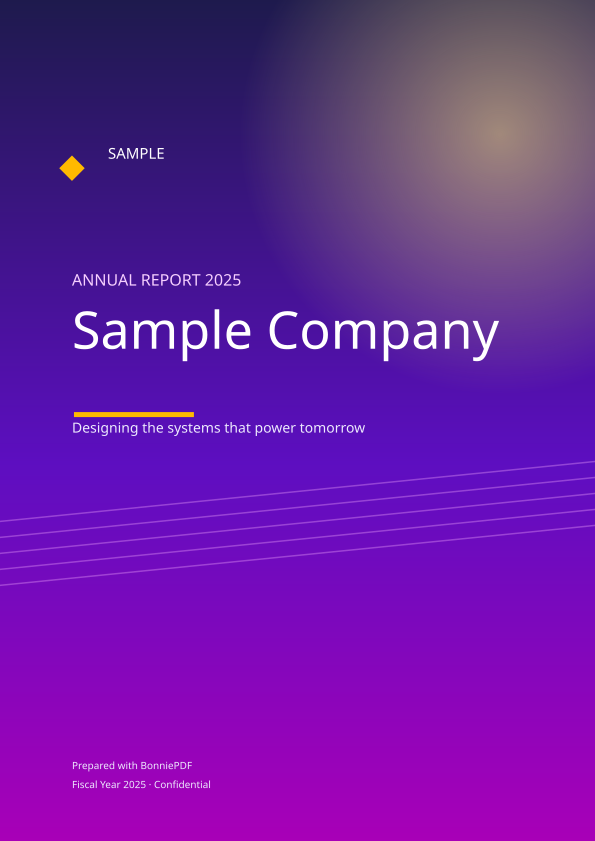
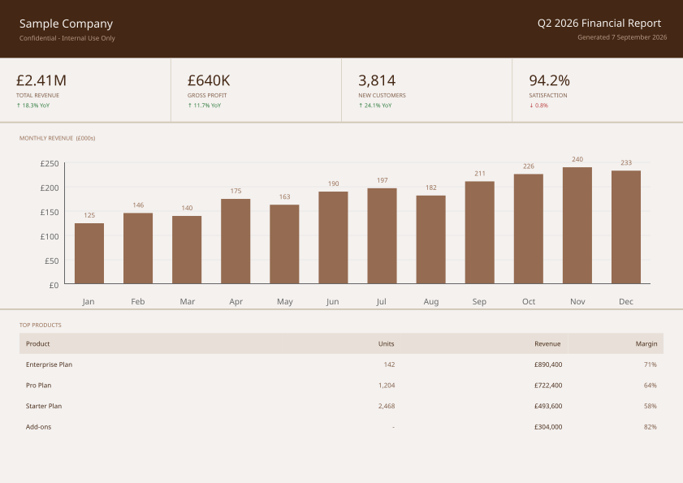
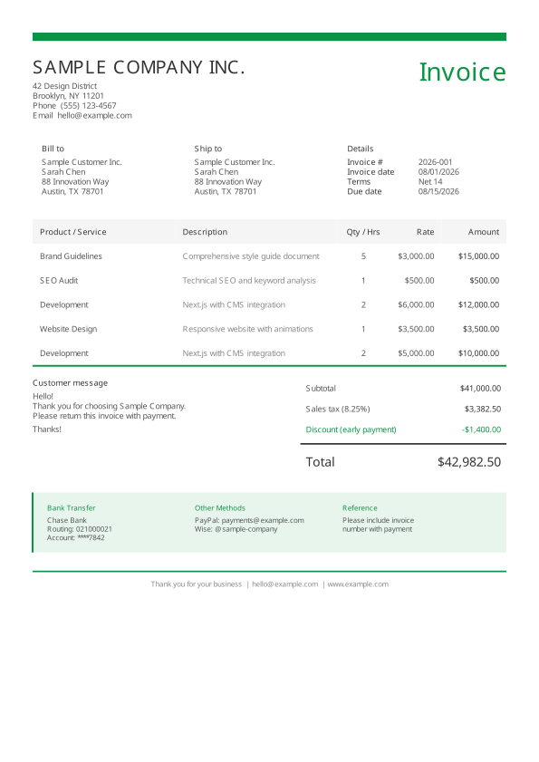
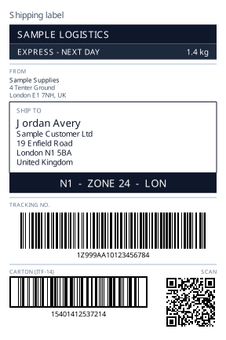
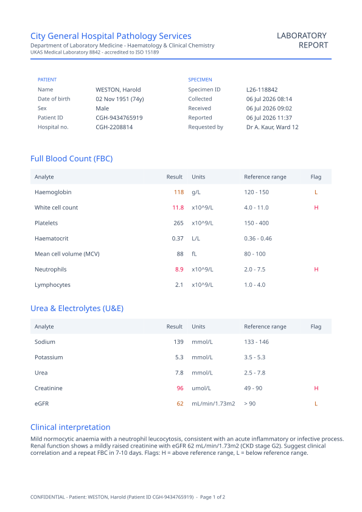
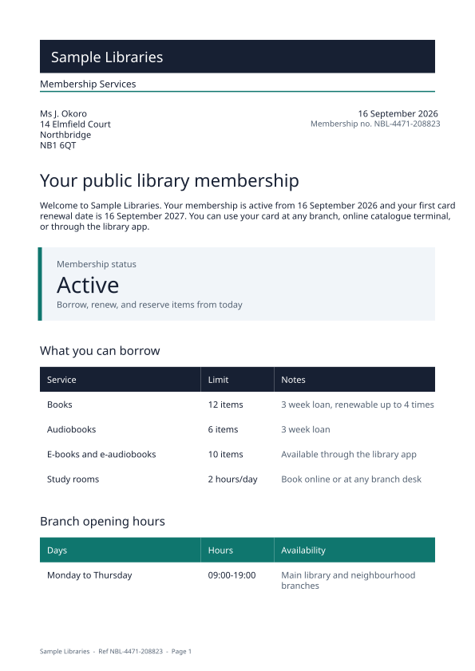

# BonniePDF for .NET

[](https://www.nuget.org/packages/BonniePDF)
[](https://www.nuget.org/packages/BonniePDF)
[](./LICENSE)


[Live examples](https://www.bonniepdf.dev/examples) · [Documentation](https://www.bonniepdf.dev/docs/dotnet/getting-started) · [NuGet](https://www.nuget.org/packages/BonniePDF) · [TypeScript package](https://www.npmjs.com/package/@bonniepdf/core)

Create polished, tagged and preservation-focused PDFs directly from C#. BonniePDF is a pure managed .NET document engine with automatic layout and pagination, vector charts, embedded fonts, PDF/UA tagging and PDF/A profile support—all with zero dependencies and no Chromium, `System.Drawing`, SkiaSharp or native binaries.

BonniePDF creates new PDFs from code. It is not an HTML converter, PDF parser, form filler or editor for existing files.

## What you can build

<table>
  <tr>
    <td width="33%" align="center">
      <a href="https://github.com/bonniepdf/BonniePDF-NET/blob/master/docs/pdf/annual-report.pdf">
        
      </a>
    </td>
    <td width="33%" align="center">
      <a href="https://github.com/bonniepdf/BonniePDF-NET/blob/master/docs/pdf/financial-dashboard.pdf">
        
      </a>
    </td>
    <td width="33%" align="center">
      <a href="https://github.com/bonniepdf/BonniePDF-NET/blob/master/docs/pdf/business-invoice.pdf">
        
      </a>
    </td>
  </tr>
  <tr>
    <td align="center"><strong>Annual reports</strong><br />Gradient shadings, vector composition and cover typography<br /><a href="https://github.com/bonniepdf/BonniePDF-NET/blob/master/docs/pdf/annual-report.pdf">View PDF</a> · <a href="https://www.bonniepdf.dev/examples/reports/annual-report-gradient-cover">Live example</a></td>
    <td align="center"><strong>Executive dashboards</strong><br />KPIs, charts and data-rich tables<br /><a href="https://github.com/bonniepdf/BonniePDF-NET/blob/master/docs/pdf/financial-dashboard.pdf">View PDF</a> · <a href="https://www.bonniepdf.dev/examples/reports/financial-dashboard">Live example</a></td>
    <td align="center"><strong>Business documents</strong><br />Automatic layout, flow and pagination<br /><a href="https://github.com/bonniepdf/BonniePDF-NET/blob/master/docs/pdf/business-invoice.pdf">View PDF</a> · <a href="https://www.bonniepdf.dev/examples/invoices/business-invoice">Live example</a></td>
  </tr>
  <tr>
    <td width="33%" align="center">
      <a href="https://github.com/bonniepdf/BonniePDF-NET/blob/master/docs/pdf/shipping-label.pdf">
        
      </a>
    </td>
    <td width="33%" align="center">
      <a href="https://github.com/bonniepdf/BonniePDF-NET/blob/master/docs/pdf/pathology-lab-report.pdf">
        
      </a>
    </td>
    <td width="33%" align="center">
      <a href="https://github.com/bonniepdf/BonniePDF-NET/blob/master/docs/pdf/public-library-membership.pdf">
        
      </a>
    </td>
  </tr>
  <tr>
    <td align="center"><strong>Shipping labels</strong><br />Barcodes, QR codes and precision page sizing<br /><a href="https://github.com/bonniepdf/BonniePDF-NET/blob/master/docs/pdf/shipping-label.pdf">View PDF</a> · <a href="https://www.bonniepdf.dev/examples/operations/shipping-label">Live example</a></td>
    <td align="center"><strong>Clinical reports</strong><br />Structured clinical data and accessible tables<br /><a href="https://github.com/bonniepdf/BonniePDF-NET/blob/master/docs/pdf/pathology-lab-report.pdf">View PDF</a> · <a href="https://www.bonniepdf.dev/examples/healthcare/lab-report">Live example</a></td>
    <td align="center"><strong>Public-service letters</strong><br />Multi-page typography and branded layouts<br /><a href="https://github.com/bonniepdf/BonniePDF-NET/blob/master/docs/pdf/public-library-membership.pdf">View PDF</a> · <a href="https://www.bonniepdf.dev/examples/community/public-library-membership-letter">Live example</a></td>
  </tr>
</table>

Every example is generated by BonniePDF. Explore the complete [live example gallery](https://www.bonniepdf.dev/examples) with source code for both .NET and TypeScript.

## Why BonniePDF

- **Pure managed .NET.** No browser process, native library, platform-specific graphics stack or print server.
- **Automatic document layout.** Compose pages from text, containers, rows, columns, tables, lists, images and charts; BonniePDF measures, flows and paginates them.
- **Accessibility built in.** Produce tagged PDF/UA-1 documents with semantic headings, paragraphs, tables, lists, figures and alternative text.
- **Archival output.** Generate PDF/A-1, PDF/A-2, PDF/A-3 and PDF/A-4 documents with the required metadata, colour profiles and font handling.
- **Production features.** Async generation, AES-256 encryption, attachments, Factur-X/ZUGFeRD invoices, barcodes, QR codes and SVG page export.
- **Two idiomatic APIs.** Use the fluent builder or the traditional object model. Both feed the same engine and produce equivalent output.
- **Cross-language parity.** The .NET and TypeScript packages are co-equal implementations of the same language-neutral BonniePDF specification.

## Install

```bash
dotnet add package BonniePDF
```

BonniePDF targets .NET 8 and .NET 10 and runs on Windows, Linux and macOS.

## Quick start

First, declare which licence applies to you — once, at application startup. It is a
self-declaration: no key, no activation, no telemetry. See [Licence](#licence).

```csharp
using BonniePDF;

BonniePdfLicense.Tier = LicenseTier.Community;
// or Evaluation / Professional / Enterprise
```

Then build a document:

```csharp
using BonniePDF;

Document document = new();

document.Metadata = new DocumentMetadata
{
    Title = "Quarterly report",
    Author = "Northwind Analytics"
};

document.Settings = new DocumentSettings
{
    Conformance = PdfAConformance.PdfA2a,
    Accessibility = AccessibilityMode.PdfUa1,
    Language = "en-GB"
};

document.Add(new Heading("Quarterly report")
{
    Level = 1,
    FontName = StandardFonts.HelveticaBold,
    FontSize = 24,
    Color = ColorPalette.Slate[800]
});

document.Add(new TextBlock
{
    Text = "Generated as a tagged, PDF/A document with no native dependencies."
});

await document.SaveAsync("quarterly-report.pdf");
```

A `Document` starts with its first page ready to use. Add elements in reading order; start another page explicitly with `AddPage()`, or let flowing elements paginate themselves.

### Fluent API

```csharp
using BonniePDF;
using BonniePDF.Fluent;

Pdf.Create(document =>
{
    document.Page(page =>
    {
        page.Content().Column(column =>
        {
            column.Item().Text("Quarterly report").Bold().FontSize(24);
            column.Item().Text("Generated with BonniePDF for .NET.");
        });
    });
}).Save("quarterly-report.pdf");
```

Generate to a file, stream or byte array:

```csharp
await document.SaveAsync("report.pdf");
await document.SaveAsync(outputStream);
byte[] bytes = await document.GenerateBytesAsync();
```

## Capabilities

Native [rotation](https://www.bonniepdf.dev/docs/dotnet/rotation) supports constrained quarter turns through `RotateClockwise(contentWidth?)` and `RotateCounterclockwise(contentWidth?)`, and free angles through `Rotate(angle)`. The object model exposes the same behavior through `Rotate`. Text stays selectable, SVG previews and link bounds follow the transform, and the subtree stays on one page. Free angles keep the original flow box and need surrounding clearance.

| Area                  | Included                                                                                                                                |
| --------------------- | --------------------------------------------------------------------------------------------------------------------------------------- |
| Layout                | Automatic page flow, stacks, weighted rows, grids, containers, layers, clipping, rounded corners, headers, footers and page backgrounds |
| Text                  | Standard PDF fonts, embedded TrueType/OpenType fonts with subsetting, Unicode, rich text, alignment, decoration and fallback fonts      |
| Tables and lists      | Weighted columns, styled cells, repeating headers, ordered/unordered lists and nested content                                           |
| Charts                | Bar, grouped bar, line, area, pie, lollipop and dot-plot charts rendered as PDF vectors or exported as SVG                              |
| Images and codes      | JPEG, PNG with alpha, SVG drawn as vectors, contain/cover/fill modes, image masking, QR, Data Matrix and linear barcodes                                      |
| Standards             | PDF/A-1 through PDF/A-4, PDF/UA-1 tagging, XMP metadata, output intents and compliance preflight                                        |
| Security and exchange | AES-256 encryption, permissions, attachments and Factur-X/ZUGFeRD e-invoices                                                            |
| Runtime               | .NET 8 and .NET 10, sync and async generation, no native dependencies                                                                    |

## Accessibility and compliance

BonniePDF generates structure while it lays out the document, so accessibility information is part of the authoring model rather than a post-processing pass. The optional layout snapshot and compliance preflight can identify missing language, title, alternative text and heading issues before delivery. The live previewer visualises both the structure tree and findings directly over the generated pages.

The repository includes veraPDF-backed validation coverage for supported PDF/A and PDF/UA claims. Machine validation does not judge whether content is meaningful or establish legal compliance. Validate final documents, fonts, and configuration against the required profile, including human accessibility review where appropriate.

## Examples and documentation

- Browse runnable projects in [`Examples/`](./Examples/).
- Explore every document in the [live example gallery](https://www.bonniepdf.dev/examples).
- Read the [.NET documentation](https://www.bonniepdf.dev/docs/dotnet/getting-started).
- See the [ASP.NET server endpoint example](./Examples/BonniePDF.Examples.Integration.ServerEndpoint/).

## Licence

Current versions are source-available under the [BonniePDF Community License 1.0](./LICENSE).

The Community licence is free for: evaluation of the complete core in non-production; personal and independent non-commercial projects; qualifying charity, education and research use; qualifying OSI-licensed open-source work; **and commercial production while the benefiting organisation's annual gross revenue is below US $1,000,000**, measured together with its affiliates. Where documents are produced for a client, the client is the benefiting organisation, not the contractor. Crossing the threshold allows ninety days to obtain a [commercial licence](./COMMERCIAL-LICENSE.txt).

Professional covers one named legal entity with unlimited developers; Enterprise additionally covers the affiliates named in your Order. One paid core licence covers both .NET and TypeScript/JavaScript, with no document, server, deployment, or end-user fees. Digital signing is included with every paid core licence at no extra charge, under the same Commercial License Agreement; the signing packages are not covered by the Community License. See the [licensing overview](https://www.bonniepdf.dev/pricing/) for details.

### Declaring your licence

BonniePDF asks your application to state which tier applies to it, once at startup:

```csharp
using BonniePDF;

BonniePdfLicense.Tier = LicenseTier.Community;
```

Or set `BONNIEPDF_LICENSE=community` in the environment, which is often easier in a container, a build agent, or CI. An in-code declaration takes precedence over the environment variable.

**This is a declaration, not an enforcement mechanism.** There is no licence key, no activation server, no telemetry, no fingerprinting, and no runtime feature gate. Nothing is sent anywhere, and every tier includes the complete feature set — tiers differ only in usage rights. The declaration exists so the terms reach the developer integrating the library, rather than nobody at all.

If you generate a document without declaring a tier:

| Where | What happens |
| --- | --- |
| Development, test, or CI (`DOTNET_ENVIRONMENT`/`ASPNETCORE_ENVIRONMENT` of `Development` or `Test`, `CI` set, a loaded test framework, or an attached debugger) | A `BonniePdfLicenseException` explaining the tiers |
| Production, or an environment we cannot classify | A single warning on `Trace` and standard error; generation proceeds |

The check runs at most once per process, and **never changes a byte of output** — there is no watermark and no free-tier degradation, and the test suite asserts byte-identical output across every tier. A live workload that never declared a tier will warn, not fail.

`BONNIEPDF_LICENSE_ENFORCEMENT=throw` makes the notice fatal everywhere; `=warn` makes it non-fatal everywhere, including in CI. There is deliberately no way to switch it off — declaring a tier is the supported way to silence it, and takes one line.

## Contributing

Issues and pull requests are welcome in the [BonniePDF-NET repository](https://github.com/bonniepdf/BonniePDF-NET). For substantial changes, please open an issue first so the behaviour can be coordinated with the shared specification and TypeScript implementation.

© 2026 CodeFocus Limited

### Emoji rendering

Monochrome outlines remain the default. To use a registered colour font, set `doc.Settings.EmojiRendering = EmojiRendering.Colour`. COLRv0 artwork renders as vector fills and CBDT/CBLC PNG artwork as embedded images in PDF and SVG. Register the font bytes with the document; no system emoji font is selected automatically. Original ZWJ, variation-selector, skin-tone and flag sequences remain selectable and extractable. A bitmap-only font requires colour mode because it has no monochrome outlines.
